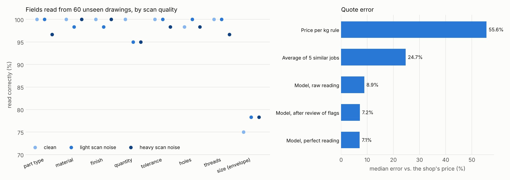

# drawing-to-quote

Turns a customer's engineering drawing into a draft quote that a person signs off. It runs four steps:

1. **Read** the drawing. OCR and computer vision pull out the material, finish, quantity, tolerance, part type, overall size, holes and threads. Each value gets a confidence score.
2. **Check** the values against engineering rules, such as a finish that can't be applied to that material, or a thread that is too deep for the wall.
3. **Find** similar past jobs.
4. **Estimate** a price. Anything the system is unsure of is flagged for a person to check, rather than guessed.



## Why it's built this way

In a machining subcontractor, quoting is usually the bottleneck. An estimator reads each drawing, re-types the key data, checks it, looks up similar jobs and prices it. The price model is the easy part. The hard part is **reading drawings reliably and knowing when the reading is wrong**. So most of the work here went into extraction and into confidence signals that predict errors. A low OCR score turned out *not* to predict errors.

## Results

**Test set.** 60 unseen synthetic parts, each rendered at three scan qualities (180 images). About 30% of the drawings have German title blocks.

**Calibration.** The review thresholds were set on a separate calibration set of 60 parts. They were then frozen before testing.

| | |
|---|---|
| Drawings with every field read correctly | **72%** raw → **98%** after review |
| Fields flagged for review | 8.9% (62% of drawings have at least one flag) |
| Reading errors caught by a flag | 93% (silent errors: 0.25% of all fields) |
| Design-rule issues found (147 planted) | recall 97%, precision 99% from the raw reading; 100% / 100% after review |
| Quote median error: price-per-kg rule / average of 5 similar jobs | 55.6% / 24.7% |
| Quote median error: model on raw reading / after review / with perfect reading | 8.9% / **7.2%** / 7.1% |
| Quotes within ±20%: raw / after review | 85% / 96% |

After review, quoting from the drawing is almost as accurate as quoting from perfect data. The simulated prices carry 8% random noise, so even a perfect model would have a median error of about 5.4%.

**Field accuracy by scan quality** (clean / light noise / heavy noise):

| Field | Accuracy |
|---|---|
| Material | 100 / 98 / 100% |
| Quantity | 100 / 95 / 95% |
| Threads | 100 / 100 / 97% |
| Overall size (envelope) | 75 / 78 / 78% |

The envelope is the weak field. When it fails, it is mostly *missing*, not wrong, and missing values are always flagged.

## How the reading works

- **OCR.** RapidOCR (PP-OCR models through ONNX) reads the sheet. A second pass on the sheet rotated by 90° picks up vertical dimension text.
- **Deskew.** Scanned sheets are levelled first, using the long straight lines of the border and title block.
- **Title block.** Labels are fuzzy-matched in English and German, and each value is taken from the cell to the right. PP-OCR's detector skips lone short strings, such as a quantity of "5". For those, the empty cell is cropped, its table rules are removed, and Tesseract reads it in single-line mode. The same recovery finds lone single-digit dimensions, such as a 5 mm plate thickness.
- **Part type.** A HOG descriptor of the main view feeds a logistic-regression classifier, which is 96.5% accurate on its own. Plate and block can look alike, so the thickness-to-width ratio is used as a second cue. When the two cues disagree, the drawing goes to review.
- **Confidence for sizes, from geometry.** OCR scores did not separate right from wrong values: 96% accuracy at scores of 0.5–0.7, against 89% above 0.7. So two checks are used instead:
  - *Scale consistency.* Drawings are to scale, so each dimension line's length in pixels should equal its value times one common scale. A value with no dimension line at all is usually a label, such as a bore note.
  - *Agreement with a second OCR engine.* Tesseract reads the same text again.

  On a sample, this caught 83% of wrong envelopes and falsely flagged 8% of correct ones.
- **Thresholds.** Each field's review threshold is the lowest one that catches 95% of that field's errors on the calibration set, without flagging more than 25% of correct values.

## Real drawings: does it fail safely?

`real_check.py` runs the reader on six real CAD drawings from the [eDOCr](https://github.com/javvi51/eDOCr) test set (MIT licence). They use title-block layouts, GD&T and materials (PLA, SS 1914, EN AW-6082) that the reader was not built for.

It reads very little of them correctly. The envelope of one drawing and the threads of a few are right. But **none of the 24 hand-labelled key fields came out silently wrong**: everything it could not read, it flagged.

Getting there needed one fix. On an unfamiliar title block, "no hole callout found" is not evidence of "no holes", so those absences are now sent to review. Results are in `results/real_check.json`.

## Honest limits

- **The drawings are synthetic.** One layout family, generated with exact ground truth. Real drawings vary far more, as the real-drawing check shows. A production system would need labelled drawings from the company and a layout-aware model, such as a document-understanding model or a cloud document-AI service, with this evaluation harness kept as the test bench.
- **The prices come from a simple simulated cost model**: material, machining minutes, finish, setup, margin and noise. Real quote history would replace `make_history()`. The model, retrieval and evaluation code would stay the same.
- **Retrieval is easy here.** Precision@5 for "same part type and material" is 100%, partly because those features are weighted. On real data, the useful measure would be whether estimators find the suggested jobs useful.
- **The rules are a small, illustrative set:** finish/material compatibility, tolerance on plastics, thread engagement and hole size. A real shop would encode its own capability limits and customer specifications.
- **Test data was regenerated once during development.** In the first version, hole callouts were drawn on top of a side view's thickness dimension, which no real drawing would do. The renderer was fixed and the test set regenerated. No thresholds or models were tuned on the test half.

## Run it

```bash
sudo apt-get install tesseract-ocr        # second OCR engine
pip install -r requirements.txt
python quote_drawing.py examples/flange_german_noisy.png   # one drawing -> fields, checks, similar jobs, draft price
python run_extract.py 120                 # render 120 parts x 3 scan qualities and read them all (~15 min, 2 CPUs)
python evaluate.py && python make_figure.py
python real_check.py path/to/eDOCr/tests/test_samples
pytest -q
```

Example output, a German flange with heavy scan noise:

```
material  Stainless Steel 304                 0.86
finish    Zinc Plate                          0.89
envelope  None                                0.00  <- check
Checks:
  [error] envelope not found on the drawing
  [error] zinc plating is for carbon steels, not Stainless Steel 304
Draft unit price: £126.24  (NOT READY: resolve errors above)
```

## Layout

```
drawquote/generate.py      synthetic drawings + simulated quote history (exact ground truth)
drawquote/extract.py       OCR, deskew, title block, callouts, recovery of missed digits, geometry checks
drawquote/train_vision.py  HOG + logistic regression part-type classifier
drawquote/validate.py      engineering rules
drawquote/model.py         LightGBM quote model, price-per-kg baseline, similar-job retrieval
evaluate.py                calibration/test split, all metrics -> results/metrics.json
real_check.py              real-drawing safety check
```
